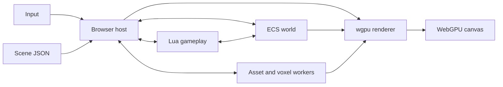

# CounterSplat

CounterSplat is a Rust game-engine project for building interactive experiences
around Gaussian-splat scans. It combines a reusable renderer, an
entity-component system (ECS), Lua gameplay scripts, scene-defined UI, asset
streaming, voxel collision, audio, and timing in one workspace.

The main interactive experience is a **live WebGPU canvas** with a level
selector, first-person controls, a pause menu, and a target-survival mode.
There is also a native scan viewer and a separate threaded integration demo.
The project is under active development; these hosts share engine crates, but
do not yet form one fully integrated, multithreaded native game.

## What works

- **Gaussian splats:** load SOG v2 scans and streamed levels, select LODs
  using a spatial octree and camera position, and fade between resident chunks.
  LOD 0 is preferred near the center of view when the data and GPU budget allow.
- **Scene and ECS:** initialize hierarchical entities, components, resources,
  scripts, and asset loading policies from JSON. A canvas-based entity browser
  and inspector expose runtime settings.
- **Lua gameplay:** drive player movement, camera behavior, weapon states,
  ballistics, HUDs, menus, and game modes through ECS components and events.
- **Player and combat:** walk, sprint, crouch, jump, aim, fire, reload, and
  tune recoil and aim stability. Projectiles have travel time and can hit
  voxel geometry or body-zone hitboxes.
- **Pursuit mode:** spawn targets that chase and damage the player, track kills
  and health, and tint damaged hitbox zones red. Start and reset a run from
  the pause menu.
- **Presentation:** draw an HDR sky background, first-person footage, impacts,
  image correction, bloom, camera effects, and an ECS UI on the canvas. The
  pause menu controls display resolution, aspect ratio, scaling, and settings.
- **Audio:** route weapon, impact, and movement events to scene-defined sound
  layers. Native audio provides a separate layered stereo mixer.

## Technology

| Area | Technology and role |
| --- | --- |
| Engine | Rust 2021 workspace, with Rust 1.96 as the minimum version. |
| Graphics | `wgpu` 30, WebGPU, and WGSL shaders; Gaussian splats are depth sorted on the GPU. |
| Browser | WebAssembly, `wasm-bindgen`, JavaScript, Web Workers, and an HTML `<canvas>`. |
| Gameplay scripting | Lua 5.4 via `mlua` on native hosts and the bundled Wasmoon runtime in the browser. |
| UI | Engine-owned ECS UI data rendered using egui and egui-wgpu 0.37. |
| Physics | Rapier 3D for native physics; Rust sparse-voxel collision queries in the browser's collision worker. |
| Audio | Kira, CPAL, and Symphonia for native layered audio; Web Audio for the current browser host. |
| Assets and scenes | SOG v2 and WebP splat data, PlayCanvas/SuperSplat sparse voxels, Radiance HDR, and versioned JSON scene manifests. |
| Windowing and time | winit for the native window; a fixed-step clock and frame scheduler in `countersplat-core`. |

## Quick start: browser canvas

### Requirements

- Rust and Cargo **1.96 or newer**, installed with rustup.
- Python **3.11 or newer** and PowerShell **7 or newer** (`pwsh`).
- A WebGPU-capable browser and GPU. The preview is served on loopback.
- A working native C toolchain to build vendored Lua for native tests; on
  Windows, install the C/C++ build tools required by the Rust toolchain.
- Node.js for the browser-side test and benchmark scripts.
- Local development assets described below. They are intentionally not
  included in Git.

Run commands from the CounterSplat project root. Install the browser target
and the exact binding-tool version used by this workspace once:

```powershell
rustup target add wasm32-unknown-unknown
cargo install wasm-bindgen-cli --version 0.2.127 --locked
```

### Supply local assets

A fresh checkout contains scene definitions, Lua scripts, and playback
metadata, but ignores level scans, the local level catalog, weapon frames,
sound files, HDR images, and build output. Restore assets you have permission
to use into the paths declared by `assets/scenes/gameplay.json`:

- `assets/levels/catalog.json` and the corresponding
  `assets/levels/<level-id>/` scan files.
- The Radiance HDR sky at
  `assets/images/environments/kloppenheim_06_puresky_1k.hdr`, or another
  compatible HDR at the scene's configured URI.
- The first-person WebP frames under `assets/images/first-person/playback/`,
  matching the scene's asset declarations and the tracked playback manifest.
- The five scene-declared MP3 files under `assets/sound/first-person/`.

The build script packages every relative asset and script URI declared by the
gameplay and menu scenes, including streamable weapon frames, and fails if a
referenced file is missing. Asset
rights are separate from the engine's code license; see
[asset notices](assets/images/first-person/ASSET-NOTICES.md) and
[third-party notices](THIRD_PARTY.md).

For a local development example, the downloader can restore the configured
The Barn scan and its published supporting files:

```powershell
python scripts/download_supersplat.py 58d333ae
# Optional thumbnail for the selector:
python scripts/download_previews.py 58d333ae
```

The downloader does not create `catalog.json`. Copy an existing catalog or
create one. For the downloaded single-scan example, a minimal catalog is:

```json
{
  "version": 1,
  "levels": [
    {
      "id": "58d333ae",
      "name": "The Barn",
      "creator": "dongiku",
      "format": "single_sog",
      "manifest": "assets/levels/58d333ae/meta.json"
    }
  ]
}
```

For a streamed level, use `"format": "streamed_sog"` and the matching
`assets/levels/<level-id>/lod-meta.json` manifest. Level IDs are eight
lowercase hexadecimal characters. A `preview.webp` thumbnail is optional;
see [development splats](assets/levels/README.md) and
[asset loading](docs/asset-loading.md).

If you choose to generate the development sound pack instead of restoring
it, `scripts/generate_game_audio.py` reads an existing `ELEVENLABS_API_KEY`
environment variable or ignored `.env.local` and makes paid API requests.
The key is not needed to run the game with existing audio files and must not
be placed in scene files or committed.

### Build and run

```powershell
pwsh -NoProfile -File scripts/build_web.ps1
python scripts/preview.py
```

Open [http://127.0.0.1:18763/](http://127.0.0.1:18763/), select a local level,
and choose **Launch level**. The selector can also open a compatible scene
from `assets/scenes/`. Press **Esc → Game mode → Start pursuit** to try the
survival mode.

The build writes Cargo output to `.artifacts/target/` and browser bindings and
packaged resources to `.artifacts/web/pkg/`. The preview server reads local
scene JSON and declared assets directly; refresh after scene or Lua edits.
Rebuild after Rust changes, changes to modules copied into the package, or
when preparing the packaged resources.

### Gameplay controls

| Input | Action |
| --- | --- |
| W / A / S / D | Move. |
| Mouse | Look; click the canvas to capture the pointer when supported. |
| Shift / Ctrl / Space | Run / crouch / jump. |
| Left / right mouse | Fire / aim down sights. |
| V | Cycle single, burst, and automatic fire. |
| R / hold R | Reload / consolidate partially filled magazines. |
| F | Stow or equip the weapon. |
| Q | Show the inspection HUD and local map. Combat actions dismiss it. |
| Backquote / tilde | Show or hide ECS tools and release mouse capture. |
| Esc | Open the pause menu; choose a level, adjust settings, or manage Pursuit. |

Bindings and preferences can be adjusted in the UI. In browsers without
pointer lock, drag to look. See [player controls](docs/player-controls.md),
[inspection HUD](docs/inspection-hud.md), and
[game modes](docs/game-modes.md).

## How the engine works




The diagram shows data relationships; the host coordinates their timing.


### Scenes, entities, and scripts

The browser loads the level selector, gameplay scene, and pause menu from
`assets/scenes/level-selector.json`, `gameplay.json`, and `menu.json`.
A scene declares component types, named resources, asset and script URIs,
loading policies, and entities. Entities have stable scene IDs, a layer,
optional same-layer parents, and components. Native components use validated
Rust adapters; dynamic components hold JSON-compatible data.

The gameplay host instantiates its scene, level, player, UI, and audio layers
in a shared ECS world. Lua scripts obtain runtime handles through the
`scene.entities` resource, read and update components, subscribe to events,
and register fixed-tick systems. Scripts register tunable ECS fields with
`engine.export` so they appear in the entity inspector. The pause menu has
its own scene and Lua runtime; scene requests move between it and gameplay.

For example, `first_person_controller.lua` emits a `weapon.shot` event.
`ballistics.lua` creates and advances a projectile, compares entity hitboxes
with level-collision results, and emits impact and damage events. Other Lua
systems can react to those events for sound, hit feedback, or game rules.
The Rust and browser hosts provide validated storage, input, timing, collision
queries, and rendering; the game-specific decisions remain in Lua.

See [scene format](docs/scenes.md), [ECS](crates/ecs/README.md),
[Lua API](crates/scripting-lua/README.md), and
[shooting and ballistics](docs/ballistics.md).

### Rendering and streaming

The asset layer reads a single SOG scan or a streamed level's
`lod-meta.json` and chunk metadata. The streamer indexes regions in an octree,
selects desired detail using camera position and direction, and requests chunks
as workers become available. Decoded data is uploaded into a bounded GPU pool.
The browser favors fine detail near the center of view, retains coarser
fallbacks where possible, and fades LOD changes; actual detail still depends on
source data, loading, and pool capacity.

The renderer builds visibility and depth-sort data, draws the splats and sky,
and composites first-person and world effects into an HDR scene target.
Image correction and optional post-processing run before the UI is drawn.
The HDR sky is a background; it does not yet provide image-based lighting to
the scan. Camera depth of field and motion blur are bounded real-time
approximations rather than a full offline film render.

See [level assets and LOD](docs/level-assets.md),
[skyboxes](docs/skybox.md), [camera](docs/camera.md), and
[post-processing](docs/post-processing.md).

### Time, physics, and threads

The browser host receives input and runs the ECS, Lua VMs, and WebGPU
orchestration on the page thread. It uses `requestAnimationFrame` and a
60 Hz fixed simulation clock, with bounded catch-up after stalls. Up to two
GPU frames can be in flight. The browser controls presentation cadence; the
optional FPS cap limits requests and cannot force true VSync off.

Metadata loading, SOG chunk decoding, HDR decoding, minimap generation, and
voxel queries use Web Workers. The decoder pool is bounded to one to four
workers. The collision worker owns the voxel data and returns asynchronous
movement, ground, clearance, and trace results; Lua consumes those results.
The current browser collision path resolves bodies against level voxels, not
general body-to-body dynamics.

On native targets, `countersplat-runtime` provides named owner threads, bounded
queues, replies, and snapshots. The threaded demo runs ECS, Lua, and Rapier
on separate workers. The native viewer separately uses asset and render
workers for offscreen work, while its windowed renderer runs on the window
thread. A unified native host with every subsystem on its own worker remains
future work.

See [threading](docs/threading.md), [timing](docs/timing.md), and
[voxel collision](docs/voxel-collision.md).

## Workspace layout

| Path | Responsibility |
| --- | --- |
| `crates/core` | Fixed simulation clock, scheduling, pacing, and logging. |
| `crates/ecs` | Entities, components, resources, hierarchy, queries, and events. |
| `crates/scene`, `crates/scene-ecs` | Scene manifests and ECS adapters for scene components. |
| `crates/scripting-lua` | Native Lua host and reusable scripting bridge. |
| `crates/assets`, `crates/shaders`, `crates/render` | Scan and environment decoding, WGSL sources, GPU rendering, sorting, and streaming. |
| `crates/physics` | Rapier world APIs and sparse-voxel collision primitives. |
| `crates/ui`, `crates/ui-ecs`, `crates/ui-wgpu` | UI data, ECS integration, and canvas rendering. |
| `crates/audio`, `crates/audio-ecs`, `crates/audio-runtime` | Layered audio, scene integration, and native audio ownership. |
| `crates/runtime` | Native workers, bounded channels, tickets, and latest-value snapshots. |
| `apps/web`, `preview` | Browser/WASM host, workers, local preview, and browser integration. |
| `apps/viewer` | Native scan inspection and rendering commands. |
| `apps/threaded-demo` | Native ECS, Lua, and physics worker integration example. |
| `assets/scenes`, `assets/scripts` | Authored scenes and Lua game behavior. |
| `tools/ecs-wasm-bench`, `scripts` | ECS bridge benchmarks, build, preview, and test utilities. |

Engine crates exchange public data and do not embed each other's source.
Applications own orchestration and connect the adapters required by a host.
See [architecture](docs/architecture.md).

## Native viewer and threaded example

```powershell
# Inspect an unpacked SOG or a streamed level.
cargo run -p countersplat-viewer -- inspect "path\to\sog-directory"
cargo run -p countersplat-viewer -- inspect-level "path\to\level"

# Open a streamed level in a native window.
cargo run -p countersplat-viewer -- window-level "path\to\level" --z180 --vsync=on

# Run the ECS, Lua, and Rapier owner-thread example for three seconds.
cargo run -p countersplat-threaded-demo -- --realtime 3
```

`window-level` expects a level directory with `lod-meta.json`. `--z180`
is an optional source-coordinate correction. The native window supports
`--vsync=off` only when the surface exposes Immediate presentation, plus
`--fps=N|monitor|unlimited`. It is a viewer and does not host the browser's
interactive gameplay UI. For additional viewer and offline-render options,
see the command usage in [apps/viewer/src/main.rs](apps/viewer/src/main.rs).

## Tests and profiling

```powershell
cargo test --workspace --locked
python scripts/test_preview.py
node scripts/test_lua_runtime.mjs
```

Browser host logic is Rust, so its tests (chunk streaming, collision coordination, the level map, audio mixing,
profiling) run with `cargo test`; the remaining JavaScript test covers the wasmoon Lua bridge.

GPU tests use an available compatible adapter and report when they must skip.
The dependency-boundary check is `python scripts/check_boundaries.py`. In
the current checkout its policy is out of date for the web host's audio ECS
dependency and the ECS WASM benchmark package, so it reports those two
existing failures.

For a local frame profile, open the preview with `?profile=1` and launch a
level. The performance panel shows submitted FPS and frame time; the
`#metrics` element also exposes a `data-profile` JSON snapshot with timed
Lua, event, render, and worker stages. Submission intervals are not GPU
execution or actual display-presentation times. See
[performance and profiling](docs/performance.md) for interpretation and
additional captures.

## Project website

The GitHub Pages landing page is in [docs/index.html](docs/index.html).
See [Pages setup and asset selection](docs/github-pages.md) for local preview
and publishing instructions.

## Source and licensing

CounterSplat-authored code is available under the [MIT License](LICENSE). The
engine port includes code derived from NeuralVisionRacer commit
`87e95586eef89acae852d75a92d69b9d8dc5745c`, which retains its
[Apache 2.0 license](third_party/neuralvisionracer/LICENSE), as well as
PlayCanvas-derived shaders and voxel techniques. Cargo package metadata reflects
the combined licenses. See [THIRD_PARTY.md](THIRD_PARTY.md) for source and
asset notices. Downloaded scans, weapon footage, generated audio, and other
local media retain their own rights and are not granted a blanket license by
this repository.
